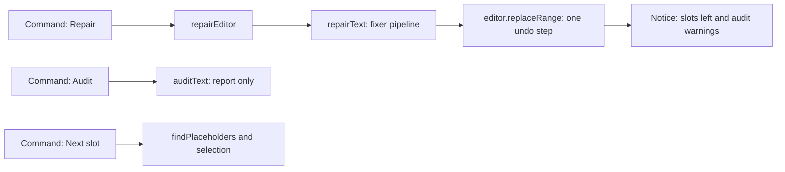

# Architecture

## Overview

Note Repair Tool is a single-file Obsidian plugin (`main.js`, no dependencies) that extends the `Plugin` class. All repair logic is plain string processing: `repairText(text)` runs a fixed sequence of fixer functions, each of which takes the whole note and returns new text. The editor commands wrap that pipeline.

## Components

| Component | Role |
| --- | --- |
| `onload` | Registers the ribbon icons, the editor menu items and the commands (`repair-current-note`, `repair-selection`, `undo-repair`, `next-placeholder`, `audit-note`) |
| `repairEditor` | Runs `repairText` and replaces the whole document with `replaceRange`, so Obsidian's undo history stays intact (`setValue` would destroy it) |
| `repairText` | The ordered fixer pipeline below |
| `auditText` | Read-only checks that return `{line, sev, msg, snippet}` items; shown in `AuditModal` and counted in the repair notice |
| `findPlaceholders`, `nextPlaceholder` | Locate image and screenshot slots and select the paste slot; copy ChatGPT image prompts |

## Fixer pipeline (order matters)

| Step | Fixer | Purpose |
| --- | --- | --- |
| 1 | `fixIndentation` | Normalize CRLF, trailing spaces, tabs |
| 1b | `fixLeaks` | Remove `[cite: ...]` markers |
| 1c | `fixMathDelimiters` | `\( \)` and `\[ \]` to `$` and `$$` |
| 2, 2b | `fixYaml`, `fixDatePlaceholder` | Clean frontmatter; fill `{{date:YYYY-MM-DD}}` |
| 2.5 | `fixHorizontalRules` | Blank lines around `---` so it never becomes a setext heading |
| 3 | `fixTables` | Merge split rows, inject missing separators |
| 4 | `fixEmbeddedCallouts` | Pull callouts out of table rows and paragraphs |
| 5 | `fixDataviewConflicts` | Protect inline Dataview fields |
| 6, 6b | `fixCallouts`, `fixCalloutMath` | Callout math boundaries, trailing empty `>`, re-quote math lines that lost the prefix |
| 7 | `fixLatex` | `\begin{array}` column specs |
| 8 | `fixMermaid` | Quote labels, plain-text labels, arrows, prefix on closing fences |
| 9 | `fixBrokenHighlights` | Unclosed `==` outside code and math |
| 10 | `fixTikz` | Rebuild TikZ blocks (see below) |
| 10b to 10d | `fixCollapsedMath`, `fixSingleDollarMathBlocks`, `fixMathJaxBlockAttributes` | Math arrays and `\cline` inside blockquotes |
| 11 | `fixBoldFormatting` | Trim spaces inside `**`, line-local |
| 12 | `fixCodeBlockLanguages` | Tag untagged fences after a "Code snippet", "Matlab" or "Python" label |
| 13 | `fixYoutubeLinks` | Links to iframes |
| 14 | `fixFunctionPlotBlocks` | Heal Functionplot YAML and hallucinated lines |
| 17 | `fixLooseLists` | Remove blank lines between list items |
| 18 | `fixSpacing` | At most one blank line outside code |

## Design rules

- **Idempotent:** a second run on repaired text must change nothing. The test suite checks this on a composite document.
- **Protect code:** fixers track code fences (and `$$` blocks where relevant) and do not rewrite their contents unless they are about that block.
- **Prefix aware:** inside callouts every line starts with `> `. Fixers read the prefix with `extractPrefix` or `/^[>\s]*/` and re-apply it.
- **No data loss:** fixers rewrite syntax, not content. Removing content (for example `[cite]` markers) is limited to explicit, documented patterns.

## Key modules

### Tables (`fixTables`)

A line-based state machine: find a header row, look ahead up to five lines for the separator, inject one if missing, then stitch following lines into a row buffer until the pipe count matches the header. Escaped pipes are ignored when counting.

### Mermaid (`fixMermaid`)

Runs on each fenced `mermaid` block. Detects `mindmap` versus flowchart, strips `%%{init}` and injects a transparent edge-label style, quotes edge labels, converts real arrows outside quoted labels, and sanitizes labels (`$`, LaTeX commands, bare `&`). A closing fence inside a callout gets the same prefix as the block.

### TikZ (`fixTikz`)

TikZJax cannot take the AI's own preamble, so the block is rebuilt:

1. Find the `tikzpicture` or `circuitikz` environment inside a `tikz`, `circuitikz`, `latex` or `tex` fence.
2. `fixTikzBody`: wrap `key=$math$` in braces, `top`/`bottom` to `above`/`below`, wrap math in node text, escape `%` and `&`.
3. `buildTikzPreamble`: choose packages (`circuitikz` or `pgfplots`, `amsmath`) and libraries from the declared preamble plus what the body needs, limited to what TikZJax bundles.
4. Re-emit the fence with the prefix on every line (blockquote aware).

### Placeholders and audit

An image slot is a line that starts with `[Paste Screenshot`, `[🖼` or `[🤖` (outside code fences). `nextPlaceholder` selects the slot after the cursor; for a `[🤖 Image Prompt ...]` line it copies the text between the first and last double quote and selects the paste slot within the next four lines. `auditText` is deliberately conservative and never edits the note.

## Testing

`tests/repair.test.js` stubs the `obsidian` module and calls the plugin directly. With `TEST_LATEX=1` it also compiles repaired TikZ with `pdflatex`. A normal LaTeX install is not the same as TikZJax (circuitikz 1.0, no `textcomp`, no `siunitx`), so `tools/tikzjax-check/` renders blocks with the real TikZJax engine in a browser; that is the ground truth used for the TikZ rules (219 blocks of a real vault render after repair, 18 failed before).

### Verified TikZJax facts

| Fact | Handling |
| --- | --- |
| `=` or `,` inside math of an option list breaks the circuitikz 1.0 label parser, even in braces | Rewritten to `\mathrel{=}` and `{,}` (`fixTikzBody`) |
| `l=R_1` without `$` fails | Wrapped in `$...$` |
| `\textbullet` and other textcomp commands hang the compiler | Replaced by math equivalents |
| `\pgfplotsset{compat=1.18}` is unknown | Preamble emits `compat=newest` |
| `decoration={brace}` needs `decorations.pathreplacing` | Added automatically |
| `top` / `bottom` are not TikZ keys | `above` / `below` |
| `to[nos]`, `o-o` | Work (an older note claimed `o-` is unsupported; not true for `o-o`) |
